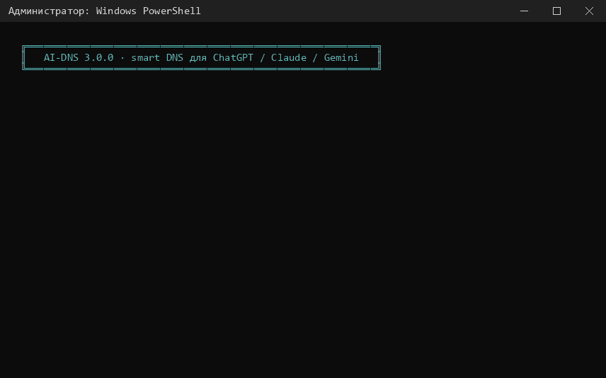

<div align="center">

# ai-dns

**Подбор рабочего smart DNS для ChatGPT, Claude и Gemini двойным щелчком с точным откатом**
<br>
**Find a working smart DNS for ChatGPT, Claude and Gemini with a double click, and roll it back exactly**

[](https://github.com/Mahiron-hq/ai-dns/releases/latest)
[](https://github.com/Mahiron-hq/ai-dns/actions/workflows/ci.yml)
[](LICENSE)
[](#)
[](https://learn.microsoft.com/powershell/)
[](#)

**[Русский](#-русский)** · **[English](#-english)**

</div>

---

## 🇷🇺 Русский

Smart DNS отвечает на запросы к сервисам с региональными ограничениями адресом своего прокси, и
ChatGPT, Claude и Gemini видят регион прокси, а не ваш. Таких серверов много, и они постоянно
появляются и исчезают. ai-dns за несколько секунд проверяет все известные серверы, открывает каждый
сервис через прокси, который сервер действительно выдаёт, и включает лучший. Настройки, которые были
до первого изменения, сохраняются и восстанавливаются в точности.

> **Перед началом.** Сервер, выбранный системным DNS, видит все домены, которые вы открываете. DNS
> меняет регион, который видит сервис, но не ваш аккаунт: заблокированный аккаунт останется
> заблокированным. Если провайдер сбрасывает TLS-соединения по имени сайта (фильтрация ТСПУ), DNS не
> поможет, и ai-dns прямо об этом сообщит.



### Установка

1. Скачайте `ai-dns-<версия>.zip` из [последнего релиза](https://github.com/Mahiron-hq/ai-dns/releases/latest).
2. Нажмите на ZIP правой кнопкой, откройте **Свойства**, отметьте **Разблокировать** и нажмите
   **OK**. Иначе Windows будет спрашивать подтверждение перед каждым `.bat`-файлом.
3. Распакуйте архив в папку, которая не будет перемещаться, например `C:\Tools\ai-dns`.
4. Запустите `AI-DNS-Enable.bat` двойным щелчком и разрешите права администратора.
5. Перезапустите браузер.

Если сервис перестал открываться, снова запустите `AI-DNS-Enable.bat`, а чтобы начать с чистого
состояния, запустите `AI-DNS-Update.bat`. После успешного завершения окно закрывается через 20 секунд,
любая клавиша закрывает его сразу.

**Новая версия.** Когда выходит новый релиз, ai-dns один раз сообщает о нём перед началом Enable,
Disable или Update и предлагает открыть страницу загрузки. Распакуйте новый архив в ту же папку с
заменой файлов: ваш `settings.json` в архив не входит и останется как есть.

**Удаление.** Запустите `AI-DNS-Disable.bat`, затем удалите папку.

### Скрипты

| Скрипт | Что делает |
|---|---|
| `AI-DNS-Enable.bat` | Проверяет серверы, включает лучший с резервным и проверяет результат |
| `AI-DNS-Disable.bat` | Восстанавливает сохранённые настройки и удаляет все следы ai-dns |
| `AI-DNS-Update.bat` | Полный откат, затем удаление кэша списков и собранного модуля, затем подбор с нуля по свежим спискам |
| `AI-DNS-Settings.bat` | Открывает меню настроек: обязательные сервисы, свои домены, ключи по умолчанию и остальное |

### Настройки

`AI-DNS-Settings.bat` открывает меню, которым управляют стрелки, `Enter`, `пробел`, `Del` и `Esc`;
цифры переходят к пункту. Каждое изменение сразу сохраняется в `settings.json` рядом со скриптами.
Disable и Update этот файл не трогают.

| Раздел | Что можно изменить |
|---|---|
| Сервисы и домены | Режим каждого сервиса: **Обязательный**, **Желательный** или **Не проверять**. По умолчанию ChatGPT и Claude обязательные, остальные желательные. Здесь же добавляются свои домены |
| Ключи по умолчанию | `-TestOnly`, `-DryRun`, `-Trace`, `-Offline`, `-Full`, `-EnableIPv6` и `-ResetNetwork`, которые включаются при каждом запуске тех действий, где они имеют смысл |
| Что менять в системе | IPv6 на адаптерах, «безопасный DNS» браузеров, записи `hosts`, маршрутизация NRPT и шаблоны DoH Windows; любую часть можно не трогать. Disable всегда возвращает всё |
| DNS-серверы | Свои адреса smart DNS, исключённые провайдеры и адреса, а также закреплённый провайдер, который становится основным, если открывает все обязательные сервисы |
| Язык, лог и окно | Язык окон, папка для логов, сколько окно остаётся открытым после успеха и уведомление о новой версии |
| Проверить состояние | Показывает текущие DNS и правила NRPT и проверяет каждый сервис через системный DNS. Ничего не меняет и не требует прав администратора |
| Запустить | Включить, проверить без изменений, обновить или выключить с текущими настройками |

**Режимы сервисов.** Серверы выбираются, только если они открывают каждый **обязательный** сервис:
сам основной сервер или через маршрут NRPT. **Желательные** сервисы учитываются при выборе. Сервис в
режиме **Не проверять** не учитывается.

**Свои домены.** Добавить можно любой сайт, например `perplexity.ai`. Домен проверяется при
добавлении: правильное имя, не пересекается со встроенными сервисами, есть адрес в DNS. Он
добавляется как обязательный и проверяется строго: ответ DNS, правильный сертификат, полностью
загружающаяся страница, а HTTP 403 и 451 считаются блокировкой (проверка ботов Cloudflare не
считается). Если обязательный сервис не открывает ни один сервер, Enable прямо называет виновника и
предлагает удалить его или сделать желательным и сразу продолжить без повторного опроса. В меню такой
сервис помечается и убирается одной клавишей.

### Запуск из PowerShell

```powershell
.\AI-DNS.ps1 -Action Enable -TestOnly      # проверить серверы, ничего не меняя
.\AI-DNS.ps1 -Action Enable                # включить лучший сервер
.\AI-DNS.ps1 -Action Update                # откат, очистка кэшей, подбор с нуля
.\AI-DNS.ps1 -Action Disable -Full         # откат с максимальной очисткой
.\AI-DNS.ps1 -Action Status                # показать настройки и проверить каждый сервис
.\AI-DNS.ps1 -Action Settings              # открыть меню настроек
```

`.bat`-файлы передают аргументы дальше, поэтому `AI-DNS-Enable.bat -TestOnly` тоже работает. Ключи,
указанные здесь, добавляются к ключам по умолчанию из настроек.

### Ключи

| Ключ | Для чего | Действие |
|---|---|---|
| `-TestOnly` | Enable | Проверить и упорядочить серверы, ничего не меняя |
| `-DryRun` | Enable, Disable, Update | Выполнить все проверки, но изменения только записать в лог |
| `-Trace` | все | Записывать в лог каждый DNS-запрос, HTTPS-проверку и изменение с состоянием до и после |
| `-Offline` | Enable, Update | Не скачивать списки провайдеров, использовать встроенный список и кэш |
| `-Full` | Disable, Update | Сбросить все адаптеры на DHCP, удалить закомментированные записи hosts, удалить служебную папку даже после ошибок |
| `-EnableIPv6` | Disable, Update | Включить IPv6 на всех адаптерах, а не только там, где его выключил ai-dns |
| `-ResetNetwork` | Disable | Дополнительно сбросить Winsock и TCP/IP, потребуется перезагрузка |
| `-Language en\|ru` | все | Язык сообщений, по умолчанию берётся из настроек, затем из языка Windows |
| `-LogDirectory <путь>` | все | Куда писать лог, по умолчанию из настроек, затем `%ProgramData%\AIDNS\logs` |
| `-NoWait` | все | Закрыть окно сразу после завершения |
| `-NoUpdateCheck` | Enable, Disable, Update | Не проверять, вышла ли новая версия |

### Как это работает

1. **Списки провайдеров.** Встроенный [`src/providers.json`](src/providers.json) объединяется с
   двумя удалёнными списками: `providers.json` из этого репозитория и общим списком
   [DnsSwitch](https://github.com/WhIteGh0s1/DnsSwitch). Каждый скачивается с GitHub с зеркалом
   jsDelivr и хранится в кэше 6 часов, а при неудачной загрузке используется старая копия. Записи с
   общим адресом или именем объединяются в одного провайдера. Добавляются свои серверы из настроек.
2. **Поиск адресов.** Актуальные адреса каждого провайдера узнаются по его именам и именам DoH через
   публичные DNS, поэтому провайдер, переехавший на новые серверы, всё равно будет найден.
3. **Эталонные ответы.** Каждый сервис разрешается через DNS Яндекса, Google и Cloudflare, чтобы
   знать его настоящие адреса и отличать прокси от прямого ответа.
4. **Опрос DNS.** Все кандидаты опрашиваются одним пакетом с одного UDP-сокета. Весь опрос занимает
   не больше двух раундов по 1,5 секунды, сколько бы серверов ни было недоступно.
5. **HTTPS-проверки.** Каждый сервис открывается по адресу, который выдал сервер. Проверяются регион
   Cloudflare из `/cdn-cgi/trace`, ответы API OpenAI, Anthropic и Gemini на фиктивный ключ, передачи,
   застревающие на середине (замедление ТСПУ), сбросы TLS по имени сайта и подменённые сертификаты.
   Сертификаты проверяются всегда, по непроверенному соединению ничего не отправляется.
6. **Выбор.** Серверы упорядочиваются по открываемым сервисам, причём обязательный сервис весит
   больше всех желательных вместе, затем по задержке DNS и TLS. Основным становится лучший сервер,
   открывающий все обязательные сервисы, резервным становится следующий, открывающий те же сервисы.
   Сервисы, которые основной не открывает, направляются на другой сервер через NRPT.
7. **Применение и проверка.** После изменений из таблицы ниже DNS-кэш очищается, и каждый сервис
   проверяется ещё раз через системный DNS, то есть так, как его видят приложения.

Если ни один сервер не работает, ничего не применяется. Адаптер, который всё ещё указывает на
неработающий smart DNS, возвращается к исходным серверам.

### Что меняется в системе

| Настройка | Enable | Disable |
|---|---|---|
| IPv4 DNS физических адаптеров со шлюзом | основной и резервный сервер | сохранённые серверы или DHCP |
| IPv6 на этих адаптерах | выключается, чтобы AAAA-ответы провайдера не шли в обход прокси | включается там, где его выключил ai-dns |
| Правила NRPT (комментарий `AIDNS`) | маршрутизация отдельных сервисов при необходимости | удаляются |
| Шаблоны DoH Windows (Windows 11) | добавляются для серверов с DoH, с откатом на UDP | удаляются |
| Политики Chrome, Edge, Brave и Firefox | встроенный «безопасный DNS» выключен | возвращаются сохранённые значения |
| Записи `hosts` для проверяемых сервисов | комментируются меткой `# AIDNS-disabled:` | раскомментируются (с `-Full` удаляются) |
| `%ProgramData%\AIDNS` | копия, состояние, кэш, логи | удаляется |

Все строки, кроме первой и последней, можно отключить в настройках. Резервная копия записывается один
раз, перед первым изменением, и повторные запуски её не перезаписывают. VPN и виртуальные адаптеры не
затрагиваются. Доступ к служебной папке есть только у администраторов: в ней лежат собранная сборка,
которую загружает процесс с повышенными правами, и копия, по которой восстанавливается реестр. Копии
версии 2.x тоже читаются.

### Провайдеры

Встроенный список включает Comss.one, GeoHide (Россия, Европа, США), Zapret DNS, DNS-AI, Malw.link,
Astracat, Mafioznik, XyZ DNS, Bez mezhau, WebShift DNS, Xbox DNS, общий пул шлюзов и иранские
антисанкционные Shecan, Begzar и Electro, всего 57 адресов. Серверы, которые не отвечают или не
открывают ни одного сервиса, отсеиваются автоматически, поэтому список составлен с запасом.

Чтобы добавить или обновить провайдера, отредактируйте [`src/providers.json`](src/providers.json).
Формат описан в [`src/providers.schema.json`](src/providers.schema.json) и проверяется в CI. Все
установленные копии подхватят изменение из репозитория в течение 6 часов, без нового релиза.

### Тестирование

В `tests/manual` лежат копии трёх скриптов для ручной проверки. Каждая пишет подробный лог в
`tests/manual/logs`:

| Копия | Меняет настройки | Лог |
|---|---|---|
| `AI-DNS-*-Trace.bat` | да | каждый запрос, проверка и изменение с состоянием до и после |
| `AI-DNS-*-DryRun.bat` | нет, изменения только записываются | то же, каждое пропущенное изменение помечено `[пробный запуск]` |

Автотесты в `tests/*.Tests.ps1` написаны на [Pester 5](https://pester.dev) и сетевые настройки не
трогают:

```powershell
Install-Module Pester -MinimumVersion 5.5.0 -MaximumVersion 5.99.99 -Scope CurrentUser
Invoke-Pester -Path .\tests
```

### Для разработчиков

| Инструмент | Что делает |
|---|---|
| `tools\Build-Release.ps1` | Собирает `dist\ai-dns-<версия>.zip` только из файлов, нужных для работы, и контрольную сумму SHA-256. Все файлы должны быть закоммичены |
| `tools\Record-Demo.ps1 -LogPath <лог>` | Делает демонстрационный GIF в `docs\` из лога настоящего запуска. Ничего не запускает; DNS до запуска, предупреждения о VPN и пути логов убираются. Нужен Python 3 с Pillow |

### Требования

- Windows 10 или 11 (включая Home)
- Windows PowerShell 5.1 и .NET Framework 4.7 или новее (входят в систему)
- Учётная запись администратора

### Коды завершения

| Код | Значение |
|---|---|
| 0 | Успешно; для Status все обязательные сервисы работают |
| 1 | Ошибка, подробности в окне и в логе |
| 2 | Нет серверов, открывающих обязательные сервисы, ничего не изменено |
| 3 | Завершено с замечаниями, см. предупреждения; для Status не работает обязательный сервис |
| 1223 | Запрос прав администратора отменён, ничего не изменено |

---

## 🇬🇧 English

A smart DNS answers requests for geo-restricted services with the address of its own proxy, so
ChatGPT, Claude and Gemini see the proxy's region instead of yours. There are many such resolvers
and they come and go. ai-dns tests all known resolvers in a few seconds, checks every service through
the proxy it actually returns and applies the best one. The settings that existed before the first
change are saved and restored exactly.

> **Before you start.** A resolver you set as system DNS sees every domain you visit. DNS changes the
> region a service sees, not your account: an account that was blocked stays blocked. When the
> provider resets TLS connections by site name (DPI filtering), no DNS can help, and ai-dns says so.

### Installation

1. Download `ai-dns-<version>.zip` from the [latest release](https://github.com/Mahiron-hq/ai-dns/releases/latest).
2. Right-click the ZIP, open **Properties**, tick **Unblock** and press **OK**. Without this, Windows
   asks for confirmation before every `.bat` file.
3. Extract the archive to a folder that will stay where it is, for example `C:\Tools\ai-dns`.
4. Double-click `AI-DNS-Enable.bat` and allow administrator rights.
5. Restart the browser.

Run `AI-DNS-Enable.bat` again whenever a service stops opening, or `AI-DNS-Update.bat` to start over
from a clean state. The window closes 20 seconds after success; press any key to close it earlier.

**New version.** When a new release is out, ai-dns mentions it once, before Enable, Disable or Update
start, and offers to open the download page. Extract the new archive into the same folder and replace
the files: your `settings.json` is not part of the archive and stays as it is.

**Uninstall.** Run `AI-DNS-Disable.bat`, then delete the folder.

### Scripts

| Script | What it does |
|---|---|
| `AI-DNS-Enable.bat` | Tests the resolvers, applies the best one with a fallback and verifies the result |
| `AI-DNS-Disable.bat` | Restores the saved settings and removes every trace of ai-dns |
| `AI-DNS-Update.bat` | Full rollback, then removes the cached lists and compiled engine, then selects a resolver from scratch with freshly downloaded lists |
| `AI-DNS-Settings.bat` | Opens the settings menu: required services, own domains, default switches and more |

### Settings

`AI-DNS-Settings.bat` opens a menu that works with the arrow keys, `Enter`, `Space`, `Del` and
`Esc`; the digits jump to an item. Every change is saved at once to `settings.json` next to the
scripts. Disable and Update never touch this file.

| Section | What can be changed |
|---|---|
| Services and domains | The mode of every service: **Required**, **Preferred** or **Not checked**. By default ChatGPT and Claude are required, everything else is preferred. Own domains are added here |
| Default switches | `-TestOnly`, `-DryRun`, `-Trace`, `-Offline`, `-Full`, `-EnableIPv6` and `-ResetNetwork`, turned on for every run of the actions that accept them |
| What Enable may change | IPv6 on the adapters, browser secure DNS, `hosts` entries, NRPT routing and Windows DoH templates, each can be left alone. Disable always reverts all of them |
| DNS servers | Own smart DNS addresses, excluded providers and addresses, and a pinned provider that becomes the primary whenever it opens every required service |
| Language, log and window | Console language, the log folder, how long the window stays open after success and the new version notice |
| Check status | Shows the configured DNS and NRPT rules and checks every service through the system resolver. Changes nothing and needs no administrator rights |
| Run | Enable, test without changes, Update or Disable with the current settings |

**Service modes.** A resolver set is chosen only if it opens every **required** service, by the primary
resolver itself or through an NRPT route. **Preferred** services count towards the choice. A service that
is **not checked** is ignored.

**Own domains.** Any site can be added, for example `perplexity.ai`. The domain is validated when it is
added: it must be a valid name, must not overlap a built-in service and must have an address in DNS. It
is added as required and checked strictly: the DNS answer, a valid certificate, a complete page, and
HTTP 403 or 451 counts as blocked (a Cloudflare bot challenge does not). If no resolver opens a
required service, Enable says which one is to blame and offers to remove it, or make it preferred, and
continue at once without probing again. The menu marks such a service and removes it with one key.

### From PowerShell

```powershell
.\AI-DNS.ps1 -Action Enable -TestOnly      # rank the resolvers, change nothing
.\AI-DNS.ps1 -Action Enable                # apply the best resolver
.\AI-DNS.ps1 -Action Update                # roll back, clear caches, enable from scratch
.\AI-DNS.ps1 -Action Disable -Full         # roll back and clean up as much as possible
.\AI-DNS.ps1 -Action Status                # show the configuration and check every service
.\AI-DNS.ps1 -Action Settings              # open the settings menu
```

The `.bat` files pass their arguments through, so `AI-DNS-Enable.bat -TestOnly` also works. Switches
given here are added to the default switches from the settings.

### Options

| Option | Applies to | Effect |
|---|---|---|
| `-TestOnly` | Enable | Rank the resolvers and stop without changing anything |
| `-DryRun` | Enable, Disable, Update | Perform every check, but only log the changes instead of making them |
| `-Trace` | all | Log every DNS query, HTTPS check and change with its state before and after |
| `-Offline` | Enable, Update | Do not download provider lists; use the bundled list and the cache |
| `-Full` | Disable, Update | Reset all adapters to DHCP, delete the commented-out hosts entries, remove the data directory even after errors |
| `-EnableIPv6` | Disable, Update | Enable IPv6 on every adapter, not only where ai-dns turned it off |
| `-ResetNetwork` | Disable | Also reset Winsock and TCP/IP; a restart is required |
| `-Language en\|ru` | all | Console language; by default it comes from the settings, then from the Windows UI language |
| `-LogDirectory <path>` | all | Where to write the log; the default is the settings, then `%ProgramData%\AIDNS\logs` |
| `-NoWait` | all | Close the window as soon as the action finishes |
| `-NoUpdateCheck` | Enable, Disable, Update | Do not look for a new release before starting |

### How it works

1. **Provider lists.** The bundled [`src/providers.json`](src/providers.json) is merged with two
   remote lists: this repository's own `providers.json` and the community list of
   [DnsSwitch](https://github.com/WhIteGh0s1/DnsSwitch). Each is downloaded from GitHub with a
   jsDelivr mirror, cached for 6 hours, and the old copy is used when a download fails. Entries that
   share an address or host are folded into one provider. Own servers from the settings are added.
2. **Discovery.** The current addresses of every provider are resolved from its host names and DoH
   host names through public resolvers, so a provider that moves to new servers is still found.
3. **Reference answers.** Every service is resolved through Yandex, Google and Cloudflare DNS to know
   its real addresses and tell a proxy from a direct answer.
4. **DNS poll.** All candidates are queried in one batch from a single UDP socket. The whole poll is
   bounded by two 1.5 s rounds, however many resolvers are dead.
5. **HTTPS checks.** Each service is opened through the address the resolver returned: the
   Cloudflare region from `/cdn-cgi/trace`, the answers of the OpenAI, Anthropic and Gemini APIs to a
   dummy key, transfers that stall half-way (DPI throttling), TLS resets by site name and forged
   certificates. Certificates are always validated; nothing is sent over an unvalidated connection.
6. **Selection.** Resolvers are ranked by the services they open, a required service outweighing all
   preferred ones together, then by DNS and TLS latency. The best resolver that opens every required
   service becomes the primary, the next one that opens the same services becomes the secondary.
   Services the primary cannot open are routed to another resolver through NRPT.
7. **Application and verification.** After the changes below, the DNS cache is flushed and every
   service is checked again through the system resolver, exactly as applications see it.

If no resolver works, nothing is applied, and an adapter that still points at a dead smart DNS is
returned to its original resolvers.

### What changes on the system

| Setting | Enable | Disable |
|---|---|---|
| IPv4 DNS of physical adapters with a gateway | primary + secondary resolver | the saved servers, or DHCP |
| IPv6 on those adapters | turned off, so ISP AAAA answers cannot bypass the proxy | turned back on where ai-dns turned it off |
| NRPT rules (comment `AIDNS`) | per-service routing when needed | removed |
| Windows DoH templates (Windows 11) | added for resolvers that serve DoH, with UDP fallback | removed |
| Chrome, Edge, Brave and Firefox policies | built-in secure DNS off | the saved values are written back |
| `hosts` entries for the checked services | commented out with `# AIDNS-disabled:` | uncommented (deleted with `-Full`) |
| `%ProgramData%\AIDNS` | backup, state, cache, logs | removed |

Each row except the first and the last can be switched off in the settings. The backup is written once,
before the first change, and repeated enables never overwrite it. VPN and virtual adapters are not
touched. The data directory is restricted to administrators, because it holds a compiled assembly
loaded by an elevated process and the backup that drives registry restores. Backups written by
version 2.x are read as well.

### Providers

The bundled list contains Comss.one, GeoHide (Russia, EU, US), Zapret DNS, DNS-AI, Malw.link,
Astracat, Mafioznik, XyZ DNS, Bez mezhau, WebShift DNS, Xbox DNS, a community pool of gateways and
the Iranian anti-sanction resolvers Shecan, Begzar and Electro: 57 addresses in total. Resolvers that
do not answer or do not open any service are filtered out automatically, so the list errs on the side
of completeness.

To add or update a provider, edit [`src/providers.json`](src/providers.json). The format is described
by [`src/providers.schema.json`](src/providers.schema.json) and checked in CI. Every installed copy
picks up the change from the repository within 6 hours, without a new release.

### Testing

`tests/manual` contains copies of the three scripts for manual testing. Every copy writes a detailed
log to `tests/manual/logs`:

| Copy | Changes settings | Log |
|---|---|---|
| `AI-DNS-*-Trace.bat` | yes | every query, check and change with before and after state |
| `AI-DNS-*-DryRun.bat` | no, changes are only logged | the same, with `[dry run]` for each skipped change |

The automated tests in `tests/*.Tests.ps1` use [Pester 5](https://pester.dev) and never touch
network settings:

```powershell
Install-Module Pester -MinimumVersion 5.5.0 -MaximumVersion 5.99.99 -Scope CurrentUser
Invoke-Pester -Path .\tests
```

### For maintainers

| Tool | What it does |
|---|---|
| `tools\Build-Release.ps1` | Builds `dist\ai-dns-<version>.zip` with only the files needed to run ai-dns, plus its SHA-256 checksum. Every file must be committed |
| `tools\Record-Demo.ps1 -LogPath <log>` | Renders the demo GIF in `docs\` from the log of a real run. Nothing is executed; the DNS in use before the run, VPN warnings and log paths are removed. Needs Python 3 with Pillow |

### Requirements

- Windows 10 or 11 (Home included)
- Windows PowerShell 5.1 and .NET Framework 4.7 or later (both ship with Windows)
- An administrator account

### Exit codes

| Code | Meaning |
|---|---|
| 0 | Success; for Status, every required service works |
| 1 | Failure, details are shown in the window and the log |
| 2 | No resolver set opens the required services; nothing was changed |
| 3 | Finished with problems, see the warnings; for Status, a required service does not work |
| 1223 | The elevation prompt was cancelled, nothing was changed |

---

## Лицензия / License

[Apache License 2.0](LICENSE). Copyright 2026 Lev Burmistrov (Mahiron-hq).
