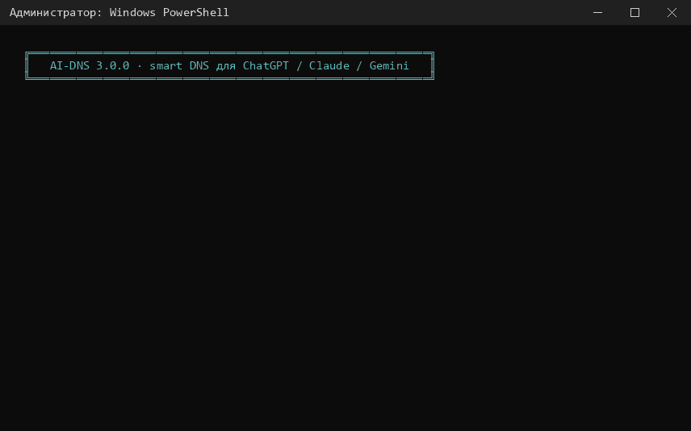

<div align="center">

# ai-dns

**Подбор рабочего smart DNS для ChatGPT, Claude и Gemini двойным щелчком с точным откатом**

[](https://github.com/Mahiron-hq/ai-dns/releases/latest)
[](https://github.com/Mahiron-hq/ai-dns/actions/workflows/ci.yml)
[](LICENSE)
[](#)
[](https://learn.microsoft.com/powershell/)
[](#)

</div>

| | |
|---|---|
| Платформа | Windows 10/11, PowerShell 5.1 |
| Лицензия | Apache-2.0 |
| Скачать | [Releases](https://github.com/Mahiron-hq/ai-dns/releases/latest) |
| Язык | русский |

---

Smart DNS отвечает на запросы к сервисам с региональными ограничениями адресом своего прокси, и
ChatGPT, Claude и Gemini видят регион прокси, а не ваш. Таких серверов много, и они постоянно
появляются и исчезают. ai-dns за несколько секунд проверяет все известные серверы, открывает каждый
сервис через прокси, который сервер действительно выдаёт, и включает лучший. Настройки, которые были
до первого изменения, сохраняются, а откат возвращает их и не трогает то, что ai-dns не создавал.

> **Перед началом.** Сервер, выбранный системным DNS, видит все домены, которые вы открываете. DNS
> меняет регион, который видит сервис, но не ваш аккаунт: заблокированный аккаунт останется
> заблокированным. Если провайдер сбрасывает TLS-соединения по имени сайта (фильтрация ТСПУ), DNS не
> поможет, и ai-dns прямо об этом сообщит.



### Установка

1. Скачайте `ai-dns-<версия>-windows.zip` из [последнего релиза](https://github.com/Mahiron-hq/ai-dns/releases/latest).
2. Нажмите на ZIP правой кнопкой, откройте **Свойства**, отметьте **Разблокировать** и нажмите
   **OK**. Иначе Windows будет спрашивать подтверждение перед каждым `.bat`-файлом.
3. Распакуйте архив в папку, которая не будет перемещаться, например `C:\Tools\ai-dns`.
4. Запустите `AI-DNS-Enable.bat` двойным щелчком и разрешите права администратора.
5. Перезапустите браузер.

Если сервис перестал открываться, снова запустите `AI-DNS-Enable.bat`, а чтобы начать с чистого
состояния, запустите `AI-DNS-Update.bat`. После успешного завершения окно закрывается через 20 секунд,
любая клавиша закрывает его сразу.

**Новая версия.** Когда выходит новый релиз, ai-dns один раз сообщает о нём перед началом Enable,
Disable или Update и предлагает открыть страницу загрузки. Распакуйте новый архив в ту же папку с
заменой файлов: ваш `settings.json` в архив не входит и останется как есть.

**Удаление.** Запустите `AI-DNS-Disable.bat`, затем удалите папку.

### Скрипты

| Скрипт | Что делает |
|---|---|
| `AI-DNS-Enable.bat` | Проверяет серверы, включает лучший с резервным и проверяет результат |
| `AI-DNS-Disable.bat` | Восстанавливает сохранённые настройки и удаляет все следы ai-dns |
| `AI-DNS-Update.bat` | Полный откат, затем удаление кэша списков и собранного модуля, затем подбор с нуля по свежим спискам |
| `AI-DNS-Settings.bat` | Открывает меню настроек: обязательные сервисы, свои домены, ключи по умолчанию и остальное |

### Настройки

`AI-DNS-Settings.bat` открывает меню, которым управляют стрелки, `Enter`, `пробел`, `Del` и `Esc`;
цифры переходят к пункту. Каждое изменение сразу сохраняется в `settings.json` рядом со скриптами.
Disable и Update этот файл не трогают.

| Раздел | Что можно изменить |
|---|---|
| Сервисы и домены | Режим каждого сервиса: **Обязательный**, **Желательный** или **Не проверять**. По умолчанию ChatGPT и Claude обязательные, остальные желательные. Здесь же добавляются свои домены |
| Ключи по умолчанию | `-TestOnly`, `-DryRun`, `-Trace`, `-Offline`, `-Full`, `-EnableIPv6` и `-ResetNetwork`, которые включаются при каждом запуске тех действий, где они имеют смысл |
| Что менять в системе | IPv6 на адаптерах, «безопасный DNS» браузеров, записи `hosts`, маршрутизация NRPT и шаблоны DoH Windows; любую часть можно не трогать. Disable всегда возвращает всё |
| DNS-серверы | Свои адреса smart DNS, исключённые провайдеры и адреса, а также закреплённый провайдер, который становится основным, если открывает все обязательные сервисы |
| Язык, лог и окно | Язык окон, папка для логов, сколько окно остаётся открытым после успеха и уведомление о новой версии |
| Проверить состояние | Показывает текущие DNS и правила NRPT и проверяет каждый сервис через системный DNS. Ничего не меняет и не требует прав администратора |
| Запустить | Включить, проверить без изменений, обновить или выключить с текущими настройками |

**Режимы сервисов.** Серверы выбираются, только если они открывают каждый **обязательный** сервис:
сам основной сервер или через маршрут NRPT. **Желательные** сервисы учитываются при выборе. Сервис в
режиме **Не проверять** не учитывается.

**Свои домены.** Добавить можно любой сайт, например `perplexity.ai`. Домен проверяется при
добавлении: правильное имя, не пересекается со встроенными сервисами, есть адрес в DNS. Он
добавляется как обязательный и проверяется строго: ответ DNS, правильный сертификат, полностью
загружающаяся страница, а HTTP 403 и 451 считаются блокировкой (проверка ботов Cloudflare не
считается). Если обязательный сервис не открывает ни один сервер, Enable прямо называет виновника и
предлагает удалить его или сделать желательным и сразу продолжить без повторного опроса. В меню такой
сервис помечается и убирается одной клавишей.

### Запуск из PowerShell

```powershell
.\AI-DNS.ps1 -Action Enable -TestOnly      # проверить серверы, ничего не меняя
.\AI-DNS.ps1 -Action Enable                # включить лучший сервер
.\AI-DNS.ps1 -Action Update                # откат, очистка кэшей, подбор с нуля
.\AI-DNS.ps1 -Action Disable -Full         # откат с максимальной очисткой
.\AI-DNS.ps1 -Action Status                # показать настройки и проверить каждый сервис
.\AI-DNS.ps1 -Action Settings              # открыть меню настроек
```

`.bat`-файлы передают аргументы дальше, поэтому `AI-DNS-Enable.bat -TestOnly` тоже работает. Ключи,
указанные здесь, добавляются к ключам по умолчанию из настроек.

### Ключи

| Ключ | Для чего | Действие |
|---|---|---|
| `-TestOnly` | Enable | Проверить и упорядочить серверы, ничего не меняя и не записывая; права администратора не нужны |
| `-DryRun` | Enable, Disable, Update | Выполнить все проверки, но изменения только записать в лог |
| `-Trace` | все | Записывать в лог каждый DNS-запрос, HTTPS-проверку и изменение с состоянием до и после |
| `-Offline` | Enable, Update | Не скачивать списки провайдеров, использовать встроенный список и кэш |
| `-Full` | Disable, Update | Сбросить все адаптеры на DHCP, удалить закомментированные записи hosts, удалить служебную папку даже после ошибок |
| `-EnableIPv6` | Disable, Update | Включить IPv6 на всех адаптерах, а не только там, где его выключил ai-dns |
| `-ResetNetwork` | Disable | Дополнительно сбросить Winsock и TCP/IP, потребуется перезагрузка |
| `-Language en\|ru` | все | Язык сообщений, по умолчанию берётся из настроек, затем из языка Windows |
| `-LogDirectory <путь>` | все | Куда писать лог, по умолчанию из настроек, затем `%ProgramData%\AIDNS\logs` |
| `-NoWait` | все | Закрыть окно сразу после завершения |
| `-NoUpdateCheck` | Enable, Disable, Update | Не проверять, вышла ли новая версия |

### Как это работает

1. **Списки провайдеров.** Встроенный [`src/providers.json`](src/providers.json) объединяется с
   двумя удалёнными списками: `providers.json` из этого репозитория и общим списком
   [DnsSwitch](https://github.com/WhIteGh0s1/DnsSwitch). Каждый скачивается с GitHub с зеркалом
   jsDelivr и хранится в кэше 6 часов, а при неудачной загрузке используется старая копия. Записи с
   общим адресом или именем объединяются в одного провайдера. Добавляются свои серверы из настроек.
2. **Поиск адресов.** Актуальные адреса каждого провайдера узнаются по его именам и именам DoH через
   публичные DNS, поэтому провайдер, переехавший на новые серверы, всё равно будет найден.
3. **Эталонные ответы.** Каждый сервис разрешается через DNS Яндекса, Google и Cloudflare, чтобы
   знать его настоящие адреса и отличать прокси от прямого ответа.
4. **Опрос DNS.** Все кандидаты опрашиваются одним пакетом с одного UDP-сокета. Весь опрос занимает
   не больше двух раундов по 1,5 секунды, сколько бы серверов ни было недоступно.
5. **HTTPS-проверки.** Каждый сервис открывается по адресу, который выдал сервер. Проверяются регион
   Cloudflare из `/cdn-cgi/trace`, ответы API OpenAI, Anthropic и Gemini на фиктивный ключ, передачи,
   застревающие на середине (замедление ТСПУ), сбросы TLS по имени сайта и подменённые сертификаты.
   Сертификаты проверяются всегда, по непроверенному соединению ничего не отправляется.
6. **Выбор.** Серверы упорядочиваются по открываемым сервисам, причём обязательный сервис весит
   больше всех желательных вместе, затем по задержке DNS и TLS. Основным становится лучший сервер,
   открывающий все обязательные сервисы, резервным становится следующий, открывающий те же сервисы.
   Сервисы, которые основной не открывает, направляются на другой сервер через NRPT.
7. **Применение и проверка.** После изменений из таблицы ниже DNS-кэш очищается, и каждый сервис
   проверяется ещё раз через системный DNS, то есть так, как его видят приложения.

Если ни один сервер не работает, ничего не применяется. Адаптер, который всё ещё указывает на
неработающий smart DNS, возвращается к исходным серверам.

### Что меняется в системе

| Настройка | Enable | Disable |
|---|---|---|
| IPv4 DNS физических адаптеров со шлюзом | основной и резервный сервер | сохранённые серверы или DHCP |
| IPv6 на этих адаптерах | выключается, чтобы AAAA-ответы провайдера не шли в обход прокси | включается там, где его выключил ai-dns |
| Правила NRPT (комментарий `AIDNS`) | маршрутизация отдельных сервисов при необходимости | удаляются |
| Шаблоны DoH Windows (Windows 11) | добавляются для серверов с DoH, с откатом на UDP | удаляются |
| Политики Chrome, Edge, Brave и Firefox | встроенный «безопасный DNS» выключен | возвращаются сохранённые значения |
| Записи `hosts` для проверяемых сервисов | комментируются меткой `# AIDNS-disabled:` | раскомментируются (с `-Full` удаляются) |
| `%ProgramData%\AIDNS` | копия, состояние, кэш, логи | удаляется |

Все строки, кроме первой и последней, можно отключить в настройках. Резервная копия записывается один
раз, перед первым изменением, и повторные запуски её не перезаписывают. Откат возвращает только то,
что изменил ai-dns: настройку, которую поменяли после включения, или похожую, но созданную не ai-dns,
он оставляет как есть и сообщает об этом. VPN и виртуальные адаптеры не затрагиваются. Изменять
служебную папку могут только администраторы: в ней лежат собранная сборка,
которую загружает процесс с повышенными правами, и копия, по которой восстанавливается реестр. Копии
версии 2.x тоже читаются.

### Провайдеры

Встроенный список включает Comss.one, GeoHide (Россия, Европа, США), Zapret DNS, DNS-AI, Malw.link,
Astracat, Mafioznik, XyZ DNS, Bez mezhau, WebShift DNS, Xbox DNS, общий пул шлюзов и иранские
антисанкционные Shecan, Begzar и Electro, всего 57 адресов. Серверы, которые не отвечают или не
открывают ни одного сервиса, отсеиваются автоматически, поэтому список составлен с запасом.

Чтобы добавить или обновить провайдера, отредактируйте [`src/providers.json`](src/providers.json).
Формат описан в [`src/providers.schema.json`](src/providers.schema.json) и проверяется в CI. Все
установленные копии подхватят изменение из репозитория в течение 6 часов, без нового релиза.

### Тестирование

В `tests/manual` лежат копии трёх скриптов для ручной проверки. Каждая пишет подробный лог в
`tests/manual/logs`:

| Копия | Меняет настройки | Лог |
|---|---|---|
| `AI-DNS-*-Trace.bat` | да | каждый запрос, проверка и изменение с состоянием до и после |
| `AI-DNS-*-DryRun.bat` | нет, изменения только записываются | то же, каждое пропущенное изменение помечено `[пробный запуск]` |

Автотесты в `tests/*.Tests.ps1` написаны на [Pester 5](https://pester.dev) и сетевые настройки не
трогают:

```powershell
Install-Module Pester -MinimumVersion 5.5.0 -MaximumVersion 5.99.99 -Scope CurrentUser
Invoke-Pester -Path .\tests
```

### Для разработчиков

| Инструмент | Что делает |
|---|---|
| `tools\Build-Release.ps1` | Собирает `dist\ai-dns-<версия>-windows.zip` только из файлов, нужных для работы, и `dist\SHA256SUMS.txt`. Все файлы должны быть закоммичены |
| `tools\Record-Demo.ps1 -LogPath <лог>` | Делает демонстрационный GIF в `docs\` из лога настоящего запуска. Ничего не запускает; DNS до запуска, предупреждения о VPN и пути логов убираются. Нужен Python 3 с Pillow |

### Требования

- Windows 10 или 11 (включая Home)
- Windows PowerShell 5.1 и .NET Framework 4.7 или новее (входят в систему)
- Учётная запись администратора

### Коды завершения

| Код | Значение |
|---|---|
| 0 | Успешно; для Status все обязательные сервисы работают |
| 1 | Ошибка, подробности в окне и в логе |
| 2 | Нет серверов, открывающих обязательные сервисы, ничего не изменено |
| 3 | Завершено с замечаниями, см. предупреждения; для Status не работает обязательный сервис |
| 1223 | Запрос прав администратора отменён, ничего не изменено |

---

## Лицензия

[Apache License 2.0](LICENSE). Copyright 2026 Lev Burmistrov (Mahiron-hq).
